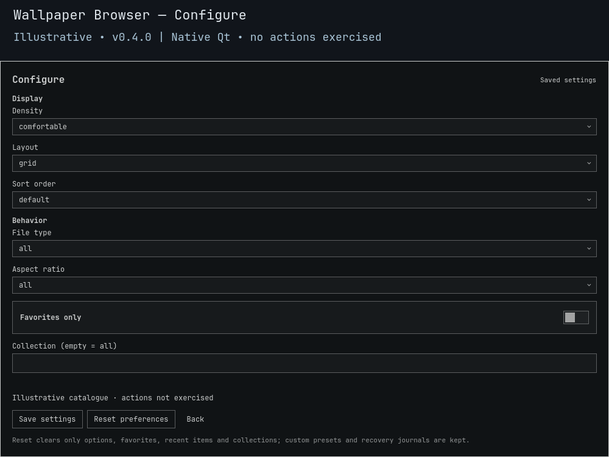

# Wallpaper Browser

**A local library you can inspect before you change the backdrop.**

Find wallpapers by name, encoded shape, folder, collection or file type. Preview a selection, shuffle to another candidate, then explicitly set the image you want. No bundled wallpaper pack, online source or rotation daemon.

> **0.4.0 development candidate — not a stable release or installed upgrade.** Offline backend fixtures exercise selection and recovery. Native UI integration, live wallpaper changes and full nested upgrade/rollback remain separate qualification gates.


*Illustrative **0.4.0** native Qt component render with fictional/original example data. No installed library, desktop action or full-shell behavior is demonstrated. [Preview provenance](docs/PREVIEW.md).*

<details>
<summary>Preview native saved settings</summary>



*Illustrative Configure view; fields may scroll. The capture does not exercise Save or Reset.*

</details>

## Install and open

Needs **Omarchy Quattro's native shell**, **Python 3.11+**, the installed background setter and shell IPC. No sibling plugin or extra service is needed. Review the source: shell plugins execute as your user, not inside a security sandbox.

```sh
omarchy plugin add https://github.com/Battlelamb/omarchy-wallpaper-browser.git --enable
omarchy-shell shell summon leviathan.wallpaper-browser
```

This Git install follows repository source rather than an unreleased candidate or stable tag. Bring your own images. Existing **Super+Space → Appearance → Wallpaper Browser** entries need no change; the summon command works without a dedicated hotkey.

## Look first, Apply second

| Control | Result |
| --- | --- |
| Type to search | Narrow the current catalogue. |
| Click a tile; arrows; Home / End | Select and preview, without applying. |
| **Enter / Set wallpaper** | Freeze safe source bytes and request that wallpaper explicitly. |
| **More → shuffle** | Select another saved-filter-matching candidate. **Does not Apply.** |
| **More → Favorite** | Toggle a saved favorite. |
| **Refresh** | Reread local sources. |
| **Esc** / click outside | Leave Configure first or dismiss the browser; accepted changes remain. |

Encoded dimensions and width:height ratio appear when bounded header inspection can identify them. Metadata orientation is not applied; unknown dimensions stay unknown. Shuffle avoids the selected tile when another eligible result exists, otherwise keeps the sole match. Apply remains a separate action. Existing desktop rotation is never created or reconfigured.

## Make the library yours

Default roots cover `~/Pictures/Wallpapers`, Omarchy user backgrounds, immediate collection subfolders, installed-theme backgrounds and staged current-theme backgrounds.

For another location, enter a **JSON array** in **Configure → Saved local folders**, for example:

```json
["/home/user/Pictures"]
```

Replace that example with your own existing user-owned absolute directory. The scan covers direct images plus **one collection-folder level**, not a recursive disk crawl. Missing/unsafe saved folders are skipped. Symlink components are not followed.

Under **More**, enter a **Collection name** and use **Add/remove item**. **Delete collection** removes the grouping, not images. Favorites, Recent and named views organize selections; Recent records confirmed Apply operations, not clicks or shuffles.

## Configure

Choose **Configure**, adjust settings, then **Save settings**.

| Setting | Default | Choices / behavior |
| --- | --- | --- |
| File type | All | All, PNG, JPEG, WebP, BMP; JPEG includes `.jpg` / `.jpeg`, case-insensitively. Classification follows the admitted image header, not a renamed suffix. |
| Aspect ratio | All | Landscape, portrait, square, ultrawide or unknown. Ultrawide is width/height ≥ 2; categories do not overlap. |
| Favorites only | Off | Only saved favorites. |
| Saved local folders | Empty | At most 32 safe user-owned absolute directories. |
| Collection | Empty | Exact named collection; empty means all. |
| Density | Comfortable | Comfortable or compact. |
| Layout | Grid | Grid or list. |
| Sort order | Default | Default, name, favorites-first; ties preserve their order. |

Type, aspect, favorite and collection filters, then saved name/favorites-first ordering, run **before the 256-tile cap** within the existing **512-file** membership. Default keeps scan order; name uses lowercase ordinal comparison and ties retain scan order. Search and Favorites/Recent/collection views operate locally on returned tiles, not all 512 files. These options do not broaden scanned roots or replace fresh action validation. Shuffle uses the saved backend-filtered and ordered displayed catalogue, not transient search text.

Preferences live outside the source at `$XDG_CONFIG_HOME/omarchy/lego/wallpaper-browser/preferences.json`, or `$HOME/.config/omarchy/lego/wallpaper-browser/preferences.json` when XDG is not absolute. **Reset preferences** forgets folders, groups, favorites, recents and options. It does not delete images, alter the desktop or erase recovery receipts. Unsafe/corrupt data is refused.

## Apply and Restore

Apply snapshots safe local bytes, checks persistent background state and requires an acknowledged non-quiet shell dispatch. That confirms **setter acceptance**, not pixels on every output. Warnings, errors or timeouts may leave partial state; a changed link alone is not success.

**Restore is one-level and ownership-checked**, using verified previous/current snapshots rather than mutable library names. Source originals can disappear without losing that recovery. External wallpaper selection or edited snapshots cause refusal. An unknown previous safe image does not acquire invented recovery authority. Restore remains available when catalogue filters match nothing.

Snapshots/receipts live under `$HOME/.local/state/omarchy-wallpaper-browser/`: **16 files / 256 MiB total**, **32 MiB per image**, no automatic pruning. Preserve active/Restore-owned snapshots. Closing, disabling or removing the plugin is not automatic undo or cleanup.

### Boundaries

- Local regular **PNG/JPEG/WebP/BMP** sources only; no file/ancestor symlinks, special files or unsafe names. Header inspection is not full codec or hostile-media certification.
- Overfull directories (**1024 entries**) are skipped. Fresh actions validate bounded membership beyond displayed tiles; replacement or metadata changes invalidate source IDs and stale favorites.
- New preference writes share **128 KiB**; valid legacy stores are bounded to **16 MiB** for reads/Reset. A later preference warning does not reverse acknowledged Apply success.

[BACKEND.md](BACKEND.md) documents exact CLI, file admission, snapshot ownership and recovery limits.

## Offline checks and troubleshooting

Set `TMPDIR` to an existing private scratch directory, then run from a checkout:

```sh
env -u PYTHONPATH /usr/bin/python3 scripts/run-tests.py --backend-only
```

The shipped bwrap runner clears HOME/environment, masks production setters and removes network/live compositor sockets. Fixture acceptance is not live wallpaper presentation. [Validation history](docs/VALIDATION.md) refers to earlier builds.

Empty library? Clear search/view/saved filters, Refresh, and check safe folder ownership and scan limits. Refused Restore? Check external wallpaper changes or snapshot edits; do not bypass the conflict guard.

```sh
omarchy-shell shell hide leviathan.wallpaper-browser
omarchy plugin disable leviathan.wallpaper-browser
# Optional; leaves images, preferences and recovery data intact:
omarchy plugin remove leviathan.wallpaper-browser
```

**GPL-3.0-only** · [License](LICENSE) · [Source notices](NOTICE.md) · [Backend attribution](NOTICE.backend.md) · [Contributing](CONTRIBUTING.md) · [Security](SECURITY.md)

Independent community plugin by Ömer Eren; not an official Omarchy or HyDE release.
