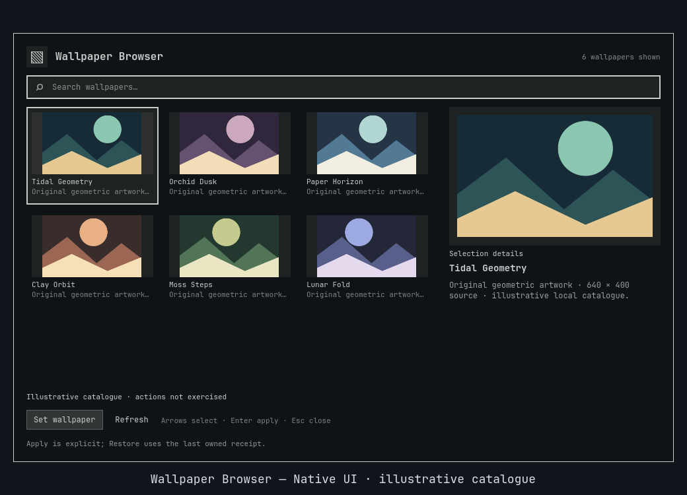

<div align="center">

# Wallpaper Browser

**Your local wallpaper library, with room to look before you choose.**

[](https://github.com/Battlelamb/omarchy-wallpaper-browser/actions/workflows/ci.yml)

[Install](#install) · [Browse](#look-first-apply-second) · [Your library](#make-the-library-yours) · [Configure](#configure) · [Restore](#apply-and-restore)

</div>

Find a backdrop by name, shape, folder or collection. Inspect the selected image, shuffle to another candidate, then explicitly set the one you want. No wallpaper pack, download service or rotation daemon comes along for the ride.

> [!IMPORTANT]
> **Development/testing source snapshot: 0.3.0, not a stable release.** The maintainer has installed and opened it for hands-on desktop testing. Live Apply/Restore and the full nested old/new/rollback sequence remain unqualified for this version.


*Historical 0.2.1 native Qt/Quickshell capture in an isolated headless compositor, using original geometric artwork and an illustrative catalogue. No wallpaper-setting or Restore action was exercised. This is not a 0.3.0 action or installation receipt. [Preview provenance](docs/PREVIEW.md).*

## Install

Needs **Omarchy Quattro's native shell**, Python **3.11+**, and the installed `omarchy-theme-bg-set` and shell IPC interfaces. It is independently usable, without another Lego plugin or an added service. Review the source before enabling: shell plugins run as your user, not in a security sandbox.

```sh
omarchy plugin add https://github.com/Battlelamb/omarchy-wallpaper-browser.git --enable
omarchy-shell shell summon leviathan.wallpaper-browser
```

This installs repository source, not a stable release tag. Bring your own local still images; your library size depends on your desktop, not this repository.

<details>
<summary>Optional: add Wallpaper Browser to Super+Space → Appearance</summary>

Back up `~/.config/omarchy/extensions/omarchy-menu.jsonc`. Merge the entry below into the existing top-level menu object, or its `items` object if present. Keep all other entries; create the file only when absent.

```jsonc
{
  "appearance.wallpaper-browser": {
    "label": "Wallpaper Browser",
    "action": "omarchy-shell shell summon leviathan.wallpaper-browser"
  }
}
```

Installation does not add this menu entry or a dedicated keybinding automatically.

</details>

## Look first, apply second

| Control | Result |
| --- | --- |
| Type to search | Narrows the current catalogue. |
| Click a tile; arrows; Home / End | Selects an image without applying it. |
| **Enter / Set wallpaper** | Freezes the selected source bytes and explicitly requests that wallpaper. |
| **More → shuffle** | Chooses a candidate from the saved backend-filtered catalogue. **Does not apply it.** |
| **More → Favorite** | Toggles a saved favorite for the selected image. |
| **Refresh** | Scans local sources again. |
| **Esc** / click outside | Leaves Configure first, or dismisses the browser. An accepted setter action is not undone. |

Wide layouts show a larger selected-image preview; compact layouts retain a scrolling detail area. Encoded dimensions and a numeric width:height ratio appear when the bounded header reader can identify them. The preview preserves aspect ratio; header dimensions do not implement every metadata-orientation convention. Unknown dimensions remain unknown.

**Shuffle is a selection tool, not rotation.** It avoids the selected image when another eligible result exists, selects the same image if it is the only match, and reports an empty catalogue honestly. It clears transient UI search/view filters so the chosen tile can be shown. Press **Set wallpaper** separately to apply it. Existing desktop wallpaper rotation is neither created nor reconfigured.

## Make the library yours

The default roots are `~/Pictures/Wallpapers`, Omarchy's user backgrounds, their immediate collection subfolders, installed-theme backgrounds and staged current-theme backgrounds.

For another location, open **Configure → Saved local folders** and enter a JSON array of absolute paths, for example:

```json
["/home/user/Pictures/Backdrops"]
```

Replace the example with your own existing directory. Each folder must belong to you and have no symlink components. The scan covers direct images plus **one collection-folder level**, not a recursive crawl of your disk. A missing or newly unsafe saved folder is skipped on later scans.

Under **More**, enter a **Collection name** and choose **Add/remove item** to toggle the selected image in that group. **Delete collection** removes only the grouping, never the source images. Use the Favorites, Recent or named-collection view to find them later. Recent records confirmed Apply operations.

## Configure

Adjust options under **Configure**, then choose **Save settings**.

| Setting | Default | Behavior |
| --- | --- | --- |
| Aspect ratio | All | Landscape, portrait, square, ultrawide or unknown. Ultrawide is width/height ≥ 2; categories do not overlap. |
| Favorites only | Off | Only saved favorites enter the backend catalogue. |
| Saved local folders | Empty | Up to 32 existing, user-owned absolute directories. |
| Collection | Empty | Exact named collection; empty means all. |

```text
$XDG_CONFIG_HOME/omarchy/lego/wallpaper-browser/preferences.json
# Fallback when XDG_CONFIG_HOME is not absolute:
$HOME/.config/omarchy/lego/wallpaper-browser/preferences.json
```

Preferences live outside the installed checkout, so source updates do not replace them. **Reset preferences** forgets saved folders, collections, favorites, recent items and filters. It does not delete images, change the wallpaper or erase Restore receipts/snapshots. Unsafe or corrupt preference data is refused, not silently overwritten.

## Apply and Restore

Apply freezes safe local source bytes, checks persistent background state, and requires an acknowledged non-quiet shell dispatch. Confirmation means **setter acceptance**, not verified pixels on every output. A warning or timeout can leave partial state; do not infer success from a changed link alone.

**Restore is one-level and ownership-checked.** It uses the last owned previous/current snapshots rather than mutable library filenames, so the originals can disappear without necessarily losing recovery. It refuses an external wallpaper selection or changed snapshot. If the prior wallpaper was outside safe bounded membership, no recoverable previous image is invented and Restore is not advertised for it.

Snapshots and the receipt live under `$HOME/.local/state/omarchy-wallpaper-browser/`. Retention is bounded to **16 files / 256 MiB**, **32 MiB per image**, with no automatic pruning. Preserve active and Restore-owned snapshots. This is not an unrestricted wallpaper history or a blanket undo of external programs; closing or disabling the browser does not restore anything automatically.

### Supported files and practical limits

- Local **PNG, JPEG, WebP and BMP** still images, at most **32 MiB each**. File/ancestor symlinks, special files and unsafe names are excluded. Codec rendering is not hostile-media certification.
- Up to **256 matching tiles** from a bounded **512-file** membership. Saved backend filters run before the tile cap; actions validate fresh membership beyond the visible subset.
- Directories with more than **1024 entries** are skipped rather than scanned without limit. No third-party wallpaper or font collection is bundled.

<details>
<summary>Verification and troubleshooting</summary>

The recorded frozen 0.3.0 offline gate passed **65 Python tests**, with **1 explicit skip**, and **51 Node component tests**. Package/native component checks add separate overlapping coverage. See [validation history](docs/VALIDATION.md) and [CI scope](docs/CI.md). The workflow badge reflects actual GitHub status, not a promised pass.

The current desktop testing deployment was opened/captured/closed with real catalogue data. Live Apply/Restore, long-soak behavior and the full nested upgrade/rollback gate are still unqualified. Earlier validation notes preserve their historical deployment status, not a stable-release claim.

From a checkout, set `TMPDIR` to an existing private scratch directory and use the shipped runner with its offline bwrap prerequisites:

```sh
env -u PYTHONPATH /usr/bin/python3 scripts/run-tests.py --backend-only
```

It clears HOME/environment, masks production setters and removes network/live compositor sockets. Fixture acknowledgements test adapter behavior, not live wallpaper presentation.

| If you see… | Try this |
| --- | --- |
| An empty or incomplete library | Clear search/view/Configure filters, Refresh, and check folder ownership, symlinks and scan limits. |
| A favorite that no longer resolves | Replacement or metadata changes give source files new IDs. Stale favorites do not authorize actions; remove or reset them. |
| A refused Restore | Check for external rotation, another wallpaper selection or edited snapshots. Do not bypass ownership checks. |
| Apply succeeded with a preference warning | A later Recent-save or optional snapshot warning does not undo the acknowledged setter operation. |

New preference writes have a shared **128 KiB** aggregate budget; individual list maxima are not all usable together. Larger bounded legacy stores remain readable for explicit Reset/recovery. [Backend CLI and exact recovery contract](BACKEND.md).

</details>

<details>
<summary>Disable or remove</summary>

Restore first if the available owned previous selection is the one you want back.

```sh
omarchy-shell shell hide leviathan.wallpaper-browser
omarchy plugin disable leviathan.wallpaper-browser
# Optional:
omarchy plugin remove leviathan.wallpaper-browser
```

Disabling/removing is not a wallpaper reset or cleanup of your images, preferences or recovery data.

</details>

---

**GPL-3.0-only** · [License](LICENSE) · [Source notices](NOTICE.md) · [Backend attribution](NOTICE.backend.md) · [Contributing](CONTRIBUTING.md) · [Security](SECURITY.md)

Independent community plugin by Ömer Eren. Not an official Omarchy or HyDE release.
